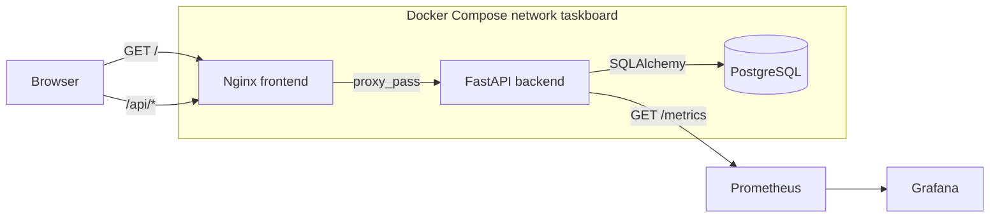
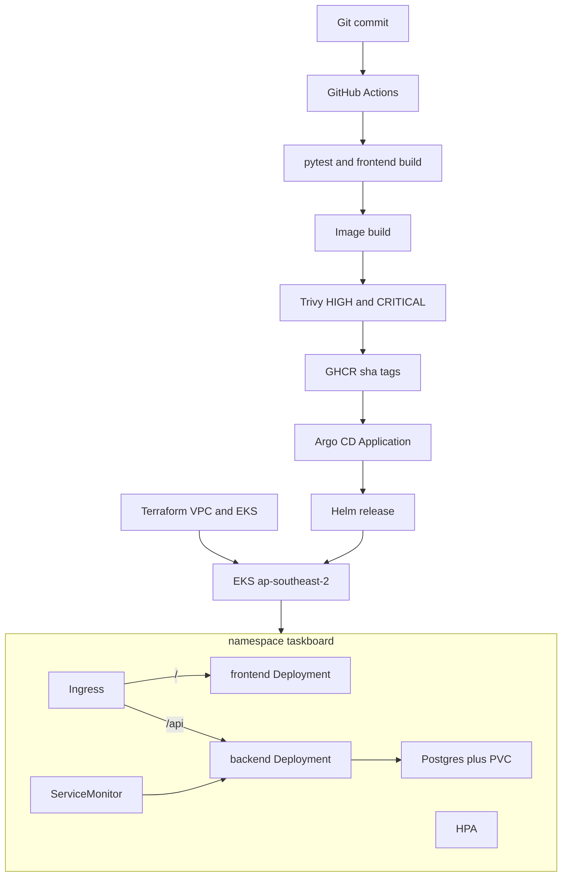

# Architecture

TaskBoard is one application with two deployable processes and one database. The production schema is applied by Alembic before Uvicorn starts. The API process does not create tables.

On Kubernetes the same split is an Ingress, not an in-cluster dependency on the Compose DNS name `backend`.

## Request path

| Caller | Path | Process |
| --- | --- | --- |
| Browser | `/` | Nginx serves the Vite build |
| Browser | `/api/tasks`, `/api/stats` | Nginx or Ingress forwards to FastAPI |
| Kubernetes | `/health` | Liveness, no database call |
| Kubernetes | `/ready` | Readiness, `SELECT 1` |
| Prometheus | `/metrics` | FastAPI instrumentator plus TaskBoard counters |

## Data

Table `tasks` is created by revision `0001_create_tasks`. Columns: `id`, `title`, `description`, `priority`, `status`, `assignee`, `created_at`. Index `ix_tasks_status` supports the stats query.

## What is intentionally outside the healthy release

`troubleshooting/broken-image.yaml` and `troubleshooting/broken-service.yaml` target namespace `taskboard-troubleshoot`. Helm does not render them.
